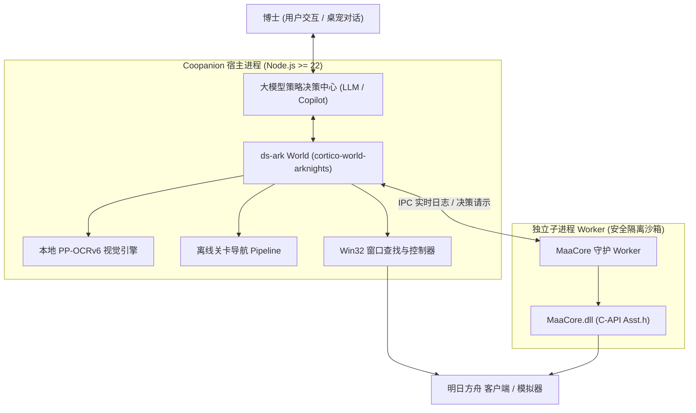

# ds-ark (cortico-world-arknights)

> **让你的桌宠玩明日方舟的 World 扩展与全权自主战斗/肉鸽托管插件**

[](LICENSE)
[]()
[]()
[]()

`ds-ark` 是基于 **Coopanion (Cortico 框架)** 的国服《明日方舟》PC 客户端深度集成与大模型自主代理扩展。它将计算机视觉（本地 PP-OCRv6）、MaaCore 官方底层 C++ 驱动与大语言模型的战术思维相结合，让桌面伴侣/桌宠不仅能够“看见”和“感知”游戏画面，更能以专业博士的策略思维主导整场常规战斗与**集成战略（肉鸽）全流程探索**。

---

## ✨ 核心特性

### 1. MaaCore 原生全权托管 (C-API 直连 + 独立子进程隔离)
- **底层直连**：基于 `koffi` 直接挂载官方桌面版 `MaaCore.dll`，支持毫秒级 `DXGI / GDI` 截屏与 `SendMessage / PostMessage` 键鼠级后台输入；
- **子进程安全隔离**：外部 C++ 库加载与原生调用移入独立 Node.js 子进程运行，杜绝堆损坏（0xC0000374 / 0xC0000005）对桌宠宿主进程的任何干扰。

### 2. 集成战略 (肉鸽 / Roguelike) 人机协同与全权自主决策
- **多主题覆盖**：原生适配黑流树海 (BlackFlow)、萨卡兹 (Sarkaz)、萨米 (Sami)、水月 (Mizuki)、傀影 (Phantom) 5 大肉鸽主题；
- **开局决策彻底解耦**：
  - 彻底杜绝 MAA 原生流水线抢跑点击默认选项；
  - 大模型自主选择开局分队（如“远程战术分队”、“突击战术分队”）与职业招募组合（如“攻守兼备”、“先手必胜”）；
  - 内置完善的别名自动纠偏（如自动将常见的“攻坚备战”纠正为游戏内正式名称“攻守兼备”）；
  - 自动支持横向卡片轮播滑屏寻卡；
- **初始与局中自主招募 (方案A 升级版)**：
  - 遇到招募界面自动挂起并向大模型推送请示；
  - 支持视觉大模型 12 格干员卡片定位，特别针对艺术字姓名 OCR 漏读难题，全新支持 `slot: 1~12`（3×4 卡片槽位）与归一化坐标精准招募；
- **大地图选路决策**：遇到路线分岔自动停手请示，大模型根据当前构筑战力推演选择最优前进分支；
- **战前编队裁决**：拦截盲目下人，自主调配 6~10 人精锐出战阵容，规避高费卡手卡费；
- **控制权随时交还**：支持 `ark_stop_roguelike` 毫秒级安全杀死后台进程，瞬间归还鼠标与游戏控制权。

### 3. Copilot 战术计划解析与自动战斗
- 支持大模型读取编队信息后自主编写 Copilot JSON 战术动作，或拉取低配作业；
- 原生驱动自动识别干员人脸、费用 CD、安全落位与技能释放，稳定通关。

### 4. 离线隐私与本地安全
- 内置轻量化 PP-OCRv6 视觉模型与关卡寻路 Pipeline；
- 全流程本地运算，不上传游戏账号或截图数据。

---

## 🏗️ 架构流向图



---

## 🛠️ 工具能力一览表

| 工具名称 | 功能描述 | 交互/托管机制 |
|---|---|---|
| `ark_connect` | 枚举并连接明日方舟 PC 客户端/模拟器窗口 | 读取窗口类名与真实分辨率 |
| `ark_screencap` | 抓取当前游戏画面一帧 | 提供 PNG 供大模型多模态视觉审视 |
| `ark_enter_stage` | 通过内置 Pipeline 导航至指定关卡编队页 | 自动处理章节切换与理智读数 |
| `ark_run_copilot` | 使用 MaaCore 或内置轻量执行器全权托管战斗 | 自动费用监控、识别人脸、精准部署 |
| `ark_run_roguelike` | 启动集成战略全权自主托管探索 | 全主题支持，集成四大自主决策请示 |
| `ark_roguelike_select_squad` | 开局分队与职业招募组合自主决策 | 支持全分队/全组合、别名纠偏与自动滑屏 |
| `ark_roguelike_select_recruit` | 局中干员招募自主决策（方案A） | 支持名称、`slot: 1~12` 网格序号与坐标 |
| `ark_roguelike_select_node` | 肉鸽大地图分支节点规划决策 | 自主选择前进节点与关卡类型 |
| `ark_roguelike_confirm_formation`| 战前精简编队调整完毕确认进战 | 杜绝盲目自动编队，锁定核心战力 |
| `ark_stop_roguelike` | 紧急终止探索并瞬间交还鼠标控制权 | 毫秒级释放子进程与互斥锁 |
| `ark_battle_state` | 识别战场费用、血量、剩余怪物与结算横幅 | 离线 OCR，只读安全 |
| `ark_click` / `ark_swipe` | 通用归一化坐标点击与拖拽滑动 | 自动受互斥锁安全保护 |

---

## 🚀 快速上手与安装

### 前置环境需求
- **操作系统**：Windows 10 / 11 (x64)
- **Node.js**：`>= 22.0.0`
- **包管理器**：`pnpm` (`corepack enable`)
- **明日方舟**：官方 PC 客户端（推荐 16:9 分辨率，如 1280×720 / 1920×1080）或主流模拟器
- **MAA 官方桌面版**（可选）：用于启用原生全权战斗与肉鸽推图引擎（如安装于 `D:/soft/MAA-v6`）

### 安装步骤
1. **克隆项目到本地**：
   ```bash
   git clone https://github.com/ExtremeNina/ds-ark.git
   cd ds-ark/cortico-world-arknights
   ```

2. **安装依赖并执行全套测试**：
   ```bash
   pnpm install
   pnpm test
   pnpm typecheck
   ```
   *(当前测试套件包含 22 个测试文件，250+ 用例 100% 通过)*

3. **挂载到 Coopanion 桌宠**：
   - 打开 Coopanion 桌面伴侣的 **扩展管理**；
   - 点击 **从本机目录安装**，选择 `cortico-world-arknights` 目录（以软链接符号形式加载）；
   - 在 **World 总览** 中启用「明日方舟」扩展；
   - 重启 Coopanion 宿主进程即可生效。

---

## 📜 许可证 (License)

本项目采用 [MIT 许可证](LICENSE)。

---

## 🙏 致谢 (Acknowledgements)

- 感谢 [MAA (MaaAssistantArknights)](https://github.com/MaaAssistantArknights/MaaAssistantArknights) 团队提供卓越的原生自动化内核与图像模板；
- 感谢 [Coopanion / Cortico](https://github.com/cortico) 团队提供的跨平台桌宠智能体架构；
- 本项目仅供技术交流与自动化辅助研究，游戏相关资源版权归属上海鹰角网络科技有限公司 (Hypergryph)。
